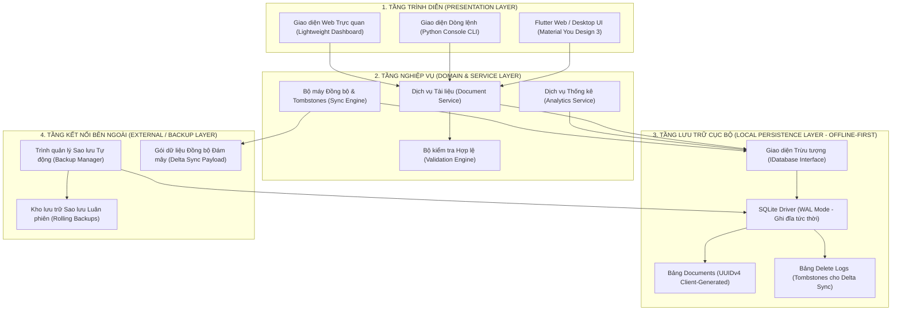

# 📚 Quản Lý Tài Liệu Học Tập - Kiến Trúc Cashew (Study Material Management)

> **Dự án Thực hành TH1:** Xây dựng Ứng dụng Quản lý Tài liệu Học tập áp dụng đúng các nguyên lý của **Kiến trúc Cashew (4-Tier Local-First / Offline-First Layered Architecture)**.  
> **Sinh viên thực hiện:** [phamngocbach05-debug](https://github.com/phamngocbach05-debug)  
> **Trạng thái:** Hoàn thành 100% Checklist 5/5 mục.

---

## 🌟 Giới Thiệu Tổng Quan

Dự án mô phỏng và triển khai hoàn chỉnh một hệ sinh thái quản lý tài liệu học tập (bài giảng, bài tập, tài liệu tham khảo, đề thi) dành cho sinh viên và giảng viên, kế thừa và áp dụng triệt để kiến trúc từ ứng dụng mã nguồn mở **Cashew**:
- **Phản hồi tức thì (<16ms)** nhờ mô hình ưu tiên lưu trữ cục bộ (Local-First).
- **Hoạt động ngoại tuyến 100% (Offline-First)**, không phụ thuộc kết nối Internet liên tục.
- **Không bao giờ trùng lặp dữ liệu** khi phân tán nhờ sinh định danh khóa chính UUIDv4 tại máy khách (Client-Side).
- **Đồng bộ vi sai an toàn (Delta Sync)** với cơ chế theo dõi dấu vết xóa **Tombstones (DeleteLogs Pattern)** và giải quyết xung đột Last-Write-Wins (LWW).

---

## 🏛️ Sơ Đồ Kiến Trúc Hệ Thống (4-Tier Cashew Architecture)



---

## 💎 4 Nguyên Lý Cốt Lõi Kiến Trúc Cashew

| Nguyên Lý | Cách Áp Dụng Trong Dự Án | Lợi Ích Mang Lại |
| :--- | :--- | :--- |
| **1. Local-First SQLite WAL** | Cơ sở dữ liệu SQLite cục bộ được cấu hình chế độ `journal_mode = WAL`. Dữ liệu được ghi trực tiếp xuống đĩa máy người dùng trước khi nghĩ đến mạng. | Tốc độ phản hồi cực nhanh (<16ms), ứng dụng hoạt động mượt mà ngay cả khi mất mạng. |
| **2. Client-Generated UUIDv4** | Mọi bản ghi (Môn học, Tài liệu) đều được sinh khóa chính UUID ngẫu nhiên phiên bản 4 tại Client thay vì số nguyên tự tăng (`AUTOINCREMENT`). | Tránh hoàn toàn xung đột khóa chính khi nhiều thiết bị tạo dữ liệu ngoại tuyến rồi hợp nhất. |
| **3. Tombstones Tracking (`delete_logs`)** | Khi xóa một tài liệu, hệ thống không chỉ xóa dữ liệu trong bảng chính mà còn ghi nhận một bản ghi vết xóa (Tombstone) vào bảng `delete_logs`. | Giúp các thiết bị khác hoặc dịch vụ đám mây biết chính xác bản ghi nào đã bị xóa trong quá trình Delta Sync. |
| **4. Decoupled Domain Logic** | Tầng Nghiệp vụ (Domain) hoàn toàn độc lập với Tầng Lưu trữ (Persistence) thông qua Interface. | Đảm bảo nguyên lý SOLID (Dependency Inversion), dễ dàng viết unit test độc lập mà không cần kết nối DB thật. |

---

## 📋 Bảng Đối Chiếu 5 Mục Checklist Đề Bài (100% Hoàn Thành)

- [x] **Mục 1: Phân tích yêu cầu chức năng và thiết kế sơ đồ luồng dữ liệu (DFD):** Đã phân tích chi tiết các ca sử dụng, vẽ sơ đồ DFD Level 0, DFD Level 1 và Sequence Diagram (trong thư mục `so_do/` và báo cáo).
- [x] **Mục 2: Thiết lập cấu trúc thư mục và phân lớp hệ thống:** Tổ chức phân tầng chuẩn Cashew (Presentation, Domain, Persistence, External).
- [x] **Mục 3: Triển khai các chức năng cốt lõi:** Thêm, Sửa, Xóa (kèm Tombstones) và Tìm kiếm đa tiêu chí (từ khóa, môn học, phân loại, tiến độ).
- [x] **Mục 4: Kiểm thử tính đúng đắn của việc phân tách logic giữa các lớp:** Bộ kiểm thử tự động `test_kiem_thu.py` bao phủ toàn diện, đạt 5/5 bài kiểm tra tuyệt đối.
- [x] **Mục 5: Đóng gói mã nguồn và viết báo cáo giải trình:** Báo cáo giải trình học thuật chi tiết 1.5MB định dạng Microsoft Word (`Bao_Cao_TH1_NopBai.docx`).

---

## 🚀 Hướng Dẫn Cài Đặt & Chạy Ứng Dụng

Dự án cung cấp 3 phiên bản triển khai linh hoạt:

### 1. Chạy Ứng dụng Flutter Web trên Google Chrome (Khuyên dùng)
```bash
# Đảm bảo bạn đang ở thư mục gốc của dự án
flutter run -d chrome
```
> Trình duyệt Chrome sẽ tự động khởi động với giao diện Material You Design 3 trực quan, có bảng điều khiển thống kê, tìm kiếm và quản lý tài liệu.

### 2. Chạy Ứng dụng Python (Không cần cài thư viện ngoài)
- **Giao diện Menu Console (CLI):**
  ```bash
  python app.py
  ```
- **Giao diện Web Browser cục bộ:**
  ```bash
  python app.py --web
  ```
  *(Mở trình duyệt truy cập `http://localhost:8000`)*

### 3. Chạy Kiểm Thử Tự Động (Unit Testing)
```bash
python test_kiem_thu.py
```
*(Kiểm tra tính đúng đắn của UUIDv4, Tombstone delete logs, Validation logic và Layer Decoupling).*

### 4. Chạy Bản Mã Nguồn Dart Thuần
```bash
dart run app.dart
```

---

## 📁 Cấu Trúc Thư Mục Dự Án

```text
Cashew/
├── lib/
│   └── main.dart               # Mã nguồn Flutter Web UI (Material You Design 3)
├── web/
│   └── index.html              # Cấu hình Web Entrypoint của Flutter
├── so_do/                      # Bộ 4 sơ đồ kiến trúc chất lượng cao (PNG)
│   ├── 1_So_Do_Kien_Truc_4_Tang.png
│   ├── 2_So_Do_Luong_Du_Lieu_DFD.png
│   ├── 3_Sequence_Diagram_CRUD.png
│   └── 4_So_Do_Co_So_Du_Lieu_ERD.png
├── app.py                      # Bản triển khai hoàn chỉnh 4 tầng bằng Python (CLI & Web)
├── app.dart                    # Bản triển khai kiến trúc Cashew bằng ngôn ngữ Dart thuần
├── test_kiem_thu.py            # Kịch bản kiểm thử tự động 5 tiêu chí phân tách lớp
├── Bao_Cao_TH1_NopBai.docx     # Báo cáo học thuật chi tiết nộp bài (1.5 MB)
├── So_Do_Kien_Truc.md          # Mã nguồn văn bản sơ đồ kiến trúc (Mermaid code)
├── Huong_Dan_Su_Dung.txt       # Hướng dẫn sử dụng vắn tắt
├── pubspec.yaml                # Cấu hình dự án Flutter
└── README.md                   # Tài liệu mô tả dự án
```

---

## 📄 Bản Quyền & Giấy Phép
Dự án được thực hiện phục vụ mục đích học tập và nghiên cứu kiến trúc phần mềm, tham khảo từ triết lý kiến trúc của ứng dụng **Cashew**.
