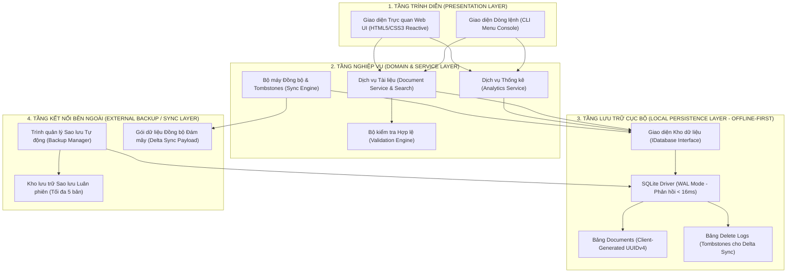
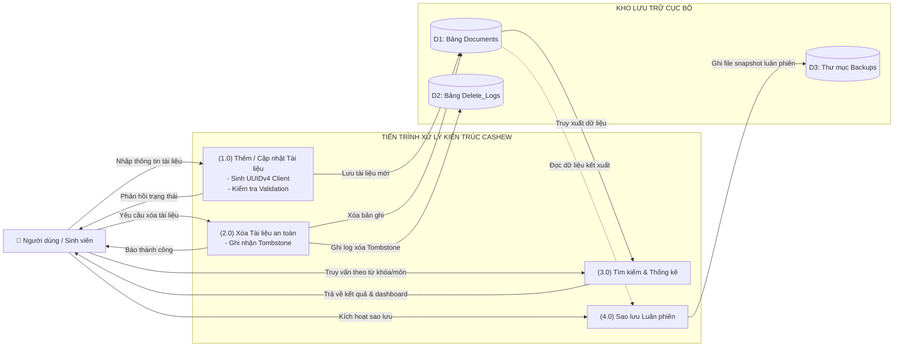
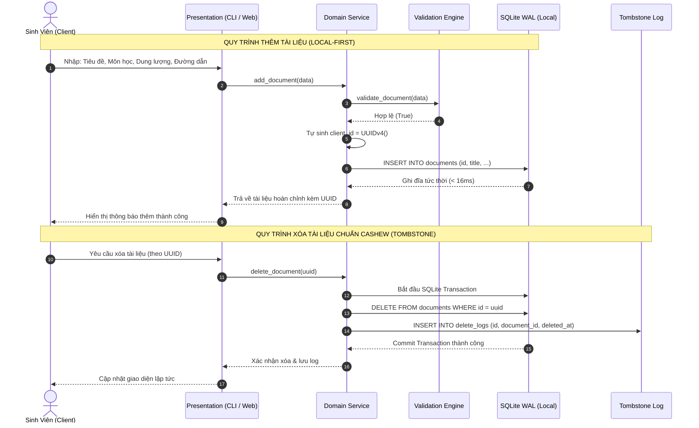
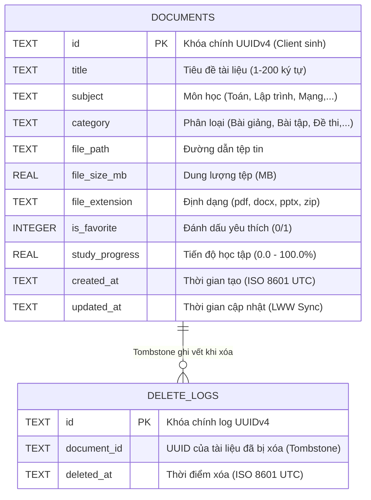

# 📊 SƠ ĐỒ KIẾN TRÚC HỆ THỐNG - QUẢN LÝ TÀI LIỆU HỌC TẬP (KIẾN TRÚC CASHEW)

Tài liệu này chứa mã nguồn văn bản dạng Mermaid của các sơ đồ kiến trúc hệ thống. Bạn có thể xem trực tiếp trong VS Code (nhấn `Ctrl + Shift + V` để mở Markdown Preview) mà không gặp bất kỳ lỗi font hay binary nào.

---

## 1. Sơ đồ Kiến trúc Tổng thể 4 Tầng (4-Tier Cashew Architecture)

---

## 2. Sơ đồ Luồng Dữ liệu (DFD - Data Flow Diagram Cấp 1)

---

## 3. Sơ đồ Tuần tự (Sequence Diagram: Thêm tài liệu & Xóa tạo Tombstone)

---

## 4. Sơ đồ Thực thể Quan hệ (ERD - Database Schema)

